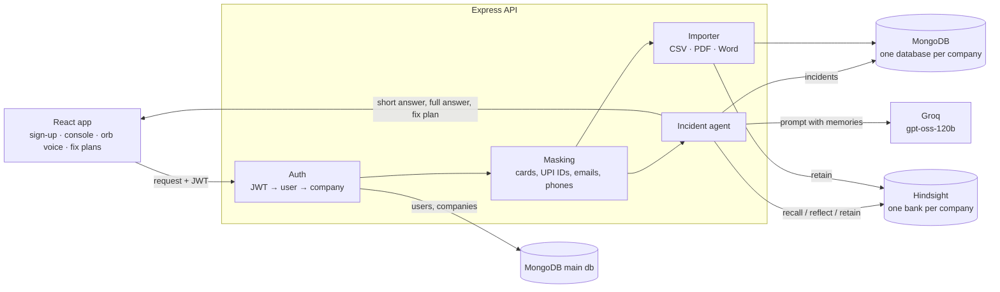

# MIRA: Memory-Integrated Response Agent

MIRA is an AI on-call engineer that learns from your company's own incident history. A company signs up, imports its past incidents, and from then on an engineer can describe any alert. MIRA recalls how similar outages were fixed (and which fixes failed), speaks a short answer out loud, shows a visual step-by-step fix plan, and learns from every "fix worked" or "didn't work".

Built for **Hack with Hyd** on **Hindsight** by Vectorize.

## Team

| Member | Role | Built |
|---|---|---|
| Afsheen Patnam ([@afsheenpatnam](https://github.com/afsheenpatnam)) | Team lead · AI agent & memory | The incident agent (routing, recall, reasoning for new issues, follow-ups, feedback), Hindsight and Groq integration, Insights, and admin MIRA's daily briefings |
| [@harshiashaik119-ctrl](https://github.com/harshiashaik119-ctrl) | Backend & security | Express API, a separate database per company, sign-up and JWT login, private-data masking, CSV/PDF/Word import, alert webhook, admin API and tamper-proof audit logs |
| G. Sreevalli ([@sreevalligodiganuru08-collab](https://github.com/sreevalligodiganuru08-collab)) | Frontend & UI/UX design | Design system, landing page, animated navigation and sections, the WebGL ember orb, sign-up and login screens, app styling |
| Sania Shaik ([@saniashaik112007-hash](https://github.com/saniashaik112007-hash)) | Voice & console experience | Spoken answers with synced subtitles, the pop-up orb, "Hey MIRA" and mic input, the chat console, fix-plan diagrams, and the sample incident datasets |

## Why memory matters here

Without memory, an assistant says "check the network and increase timeouts." With your history, MIRA says:

> "This matches INC-1014. Fail over to sms-gateway-b and send OTPs in batches. Don't bulk-retry, that made it worse last time."

Every answer has **Compare with a generic answer**, which shows what the same model says without your history.

## How it works for a company

1. **Sign up** and choose a sector (Fintech, E-commerce or EdTech). The company gets its own private workspace: its own MongoDB database and its own Hindsight memory bank.
2. **Import history** on the Data sources page: CSV exports (Jira, ServiceNow, PagerDuty or the template) and post-mortems (PDF, Word, TXT). Private data is hidden before anything is stored or sent to the AI.
3. **Ask MIRA** in the Console. It only answers once history has been imported, and its suggestions come from the company's own most frequent problems.
4. **Feedback**: "Fix worked" / "Didn't work" goes back into the company's memory.
5. **History**: every conversation (a question plus its follow-ups) can be reopened and continued.

For integrations, the API also accepts alerts from monitoring tools at `POST /api/ingest/alert` with an `X-MIRA-Key` header (key created with `POST /api/workspace/ingest-key`). This has no screen in the app yet.

## Where the data lives

| Store | What is there |
|---|---|
| MongoDB `mira` | `users` (name, email, bcrypt password hash, company), `workspaces` (company name, sector, database and bank names), `admins`, and `auditblocks` (the audit logs) |
| MongoDB `mira_<company>` | `incidents` (imported history with `source: "import"`, and questions asked in the Console with `source: "live"`, including answers, fix plans and feedback) and `sources` (import log) |
| Hindsight bank `mira-<company>` | Documents MIRA sent (imported incidents, post-mortems, feedback) and the memories Hindsight extracted from them (world facts, experiences, and observations it consolidates over time) |

Print everything stored for a company: `npm run inspect -- "Company Name"` (in `server/`).

Sample CSVs for all three sectors are in [`sample-data/`](sample-data/).

## How Hindsight is used

| Operation | When | Code |
|---|---|---|
| `createBank` | A company signs up. Sets a retain mission (extract service, root cause, fixes that worked or failed) and a reflect mission for its sector. | `server/src/routes/auth.js`, `server/src/services/hindsight.js` |
| `retainBatch` / `retain` | Imported incidents and post-mortems, and every engineer verdict on a MIRA answer. | `server/src/services/importer.js`, `recordFeedback` in `server/src/services/agent.js` |
| `recall` | A new alert comes in. MIRA pulls the most related incidents from that company's bank only. | `investigate` in `server/src/services/agent.js` |
| `reflect` | "What has MIRA learned?" and the Insights page: most common root cause, a fix that keeps failing, riskiest service. | `insights` in `server/src/services/agent.js` |
| `retain` + `recall` (platform bank) | Admin MIRA stores one usage snapshot per day (counts only) in its own bank `mira-platform-admin`, and recalls earlier snapshots so a briefing can say what changed since last time. | `askAdmin` in `server/src/services/platform.js` |

## Platform admin

`/admin` is for the team that runs MIRA. The admin opens it and asks MIRA what happened today.

- **Today**: click **Give me today's update** (or type or speak any question) and the orb pops up and speaks the answer: new companies, questions, imports, fix results and sign-in problems since midnight, which companies need attention, and what changed since yesterday. MIRA answers only from usage counts, account details and the audit logs. It never sees a company's incidents or conversations.
- **Companies**: every workspace, its people and imports, and delete-with-typed-name.
- **Audit logs**: who did what, and when (see below).

## Audit logs

The **Audit logs** page shows who did what, and when: sign-ups, logins (including failed ones), teammates and admins added from the terminal, imports, MIRA answers, fix feedback, webhook keys, rejected alerts, and admin actions (opening or deleting a company). Filter by Sign-ins, Activity, Admin or Failed, or search. Entries hold who, when and counts only, never incident text. Failed logins keep only a hint of the email that was tried.

Behind the scenes the logs are tamper-proof, blockchain-style. Each entry stores the SHA-256 fingerprint of the entry before it, and its own fingerprint is signed with the server's `AUDIT_SECRET` (HMAC-SHA-256). Editing, deleting or rewriting any past entry breaks the chain, and the app itself can only append. Check the whole chain from the terminal with `npm run audit-verify`; admin MIRA also checks it and warns if anything was changed.

## Architecture



## Security

- Each account belongs to one company. After login, the server takes that company's database and memory bank from the user record. No request carries a company id, so there is nothing to tamper with.
- Private data is masked on the server before it is stored or sent to the LLM (`server/src/services/mask.js`). Post-mortem files are read on the server so masking happens first.
- Passwords are hashed with bcrypt; JWT sessions expire after 12 hours. Webhook keys are stored only as SHA-256 hashes.
- Secrets live only in `server/.env`; the browser only talks to `/api`.
- Every sign-in, import, answer and admin action is recorded in tamper-proof audit logs (see above).
- `helmet`, CORS locked to the site origin, body size limits, and rate limits on sign-up, login, imports and questions.

## Run it locally

You need Node 20+, a MongoDB database (Atlas free tier works), a Hindsight Cloud account and a Groq API key.

```bash
# 1. API
cd server
cp .env.example .env        # fill in MONGODB_URI, JWT_SECRET, HINDSIGHT_URL, HINDSIGHT_API_KEY, GROQ_API_KEY, AUDIT_SECRET
npm install
npm run check               # tests MongoDB, Hindsight and Groq without printing keys
npm run dev                 # http://localhost:5000

# 2. Website (second terminal)
cd client
npm install
npm run dev                 # http://localhost:5173
```

Then open http://localhost:5173, sign up, and import the CSVs for your sector from `sample-data/`.

Hindsight Cloud: sign up at https://ui.hindsight.vectorize.io, add the promo code `MEMHACK99` under Billing, and create an API key. The API URL is `https://api.hindsight.vectorize.io`.

To use the platform admin page at `/admin` (all companies, usage counts, storage, delete a company), create an admin account first. Admins see counts and account details only, never a company's incidents or conversations:

```bash
npm run create-admin -- --email you@example.com --name "Your Name" --password "at-least-8-chars"
```

To add a teammate to an existing company:

```bash
npm run add-user -- --email teammate@company.com --name "Their Name" --company "Company Name" --password "at-least-8-chars"
```

If MongoDB fails with `querySrv ECONNREFUSED`, your local DNS refuses SRV lookups. The server already resolves `mongodb+srv://` addresses through public DNS; set `MONGO_DNS=system` to turn that off.

## API

All `/api/workspace` routes need `Authorization: Bearer <token>` and act on the signed-in user's own company.

| Method | Path | Does |
|---|---|---|
| POST | `/api/auth/signup` | `{ sector, company, name, email, password }` → creates the company workspace and first account |
| POST | `/api/auth/login` | Log in, returns a JWT, the user and their company |
| GET | `/api/auth/me` | The signed-in user and company |
| GET | `/api/workspace` | Company details and number of incidents learned |
| GET | `/api/workspace/suggestions` | Prompts built from the company's most frequent problems |
| POST | `/api/workspace/investigate` | Recall + answer: `{ brief, full, guide, generic, used, incidentId }` (409 until history is imported) |
| GET | `/api/workspace/incidents` | Questions asked and imported incidents |
| POST | `/api/workspace/incidents/:id/feedback` | `{ worked: true }` or `{ worked: false }`, retained into memory |
| GET | `/api/workspace/insights` | Reflect summary plus root-cause and service stats |
| GET | `/api/workspace/sources` | Import and alert activity, webhook key status |
| POST | `/api/workspace/import` | `{ files: [{ name, data (base64) }], text }` → incidents added per file |
| POST | `/api/workspace/ingest-key` | Creates a new webhook key (returned once) |
| POST | `/api/ingest/alert` | For monitoring tools. Header `X-MIRA-Key`, no login |

Admin routes (`/api/admin`, admin token only):

| Method | Path | Does |
|---|---|---|
| POST | `/login` | Admin login |
| GET | `/companies`, `/companies/:id` | Usage counts and account details |
| DELETE | `/companies/:id` | `{ confirm: "<exact name>" }` → deletes the company, its database and memory bank |
| POST | `/ask` | `{ text, recent, tz }` → admin MIRA: `{ type, brief, full, points, suggest }` |
| GET | `/audit` | Audit log entries, newest first (`category`, `problems=1`, `before`, `limit`) |

## Demo script (about 90 seconds)

1. **Sign up** as a Fintech company.
2. The Console says there is no history yet. Open **Data sources** and drop in the 10 files from `sample-data/fintech/`. Watch the import progress and the private values being hidden.
3. Back in the **Console**, the suggestions now come from your data. Ask: "OTP delivery rate dropped, sms-gateway-a returning 429".
4. The orb pops up and speaks the short answer. Then show the **fix plan** diagram and **Save as image**.
5. Click **Compare with a generic answer**, then **Fix worked**.
6. Open **Insights** and click **Read aloud**.
7. Log in at `/admin`, click **Give me today's update**, and let MIRA speak the day's briefing.
8. Open **Audit logs** and show the failed logins caught under **Failed**.

All companies, people and incidents in `sample-data/` are synthetic.
